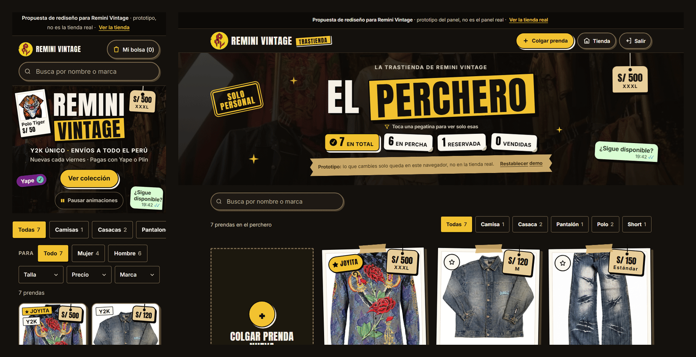
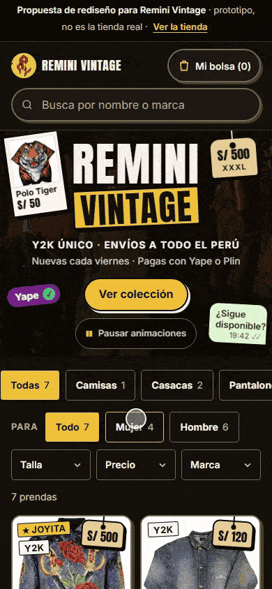
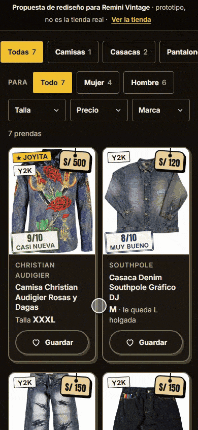
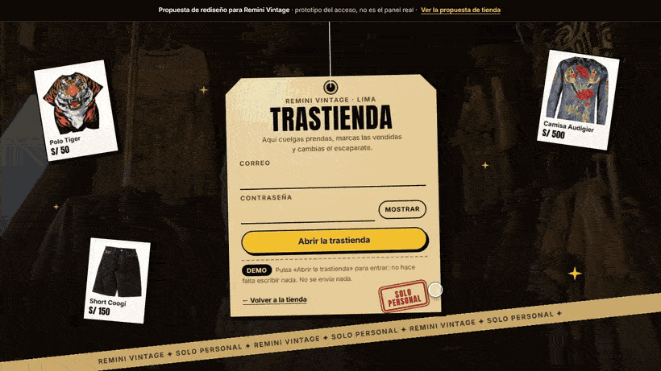
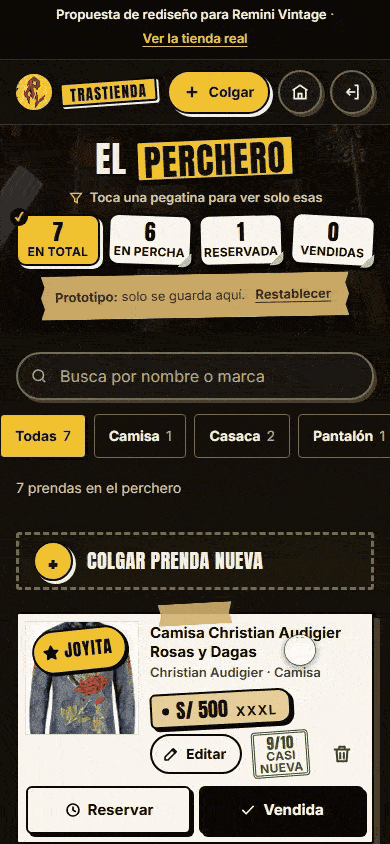

# Remini Vintage · propuesta de rediseño

Esta es una **propuesta de cómo podrían verse y funcionar la tienda y el panel de
[Remini Vintage](https://remini-vintage.vercel.app/)**. Se puede abrir y tocar en el
navegador, en el móvil o en el ordenador, sin instalar nada. Es solo una muestra: no se
vende nada desde aquí y lo que cambies se queda en tu navegador.

<h3 align="center">
  <a href="https://eduardolar.github.io/remini-vintage-propuesta/">→ Ver la tienda</a>
  &nbsp;&nbsp;·&nbsp;&nbsp;
  <a href="https://eduardolar.github.io/remini-vintage-propuesta/login.html">→ Ver el panel (se entra sin escribir nada)</a>
</h3>

<p align="center">
  <a href="https://eduardolar.github.io/remini-vintage-propuesta/">
    
  </a>
</p>

## Cómo funciona (en 1 minuto)

<table>
  <tr>
    <td align="center" width="50%">
      
      <br><b>Elegir y reservar una prenda.</b> Filtras por para quién y por tipo, abres la prenda y ves de un vistazo la talla, las medidas, el estado y cómo medir. Un toque abre WhatsApp con el mensaje de reserva ya escrito.
      <br><a href="https://eduardolar.github.io/remini-vintage-propuesta/">Probarlo</a>
    </td>
    <td align="center" width="50%">
      
      <br><b>Guardar varias y pedirlas de una vez.</b> «Mi bolsa» junta las prendas que te gustan, suma el total y prepara un solo mensaje de WhatsApp para reservarlas todas.
      <br><a href="https://eduardolar.github.io/remini-vintage-propuesta/">Probarlo</a>
    </td>
  </tr>
</table>

<p align="center">
  
  <br><b>El panel de la tienda en el ordenador.</b> Marcar una prenda como vendida es un toque (y se deshace con otro). Para colgar una nueva: foto, nombre y precio; la talla se elige estirando una cinta métrica y las medidas se ponen solas. Abajo se ve lo que falta.
  <br><a href="https://eduardolar.github.io/remini-vintage-propuesta/login.html">Probarlo</a>
</p>

<table>
  <tr>
    <td align="center" width="50%">
      
    </td>
    <td width="50%">
      <b>El panel también en el móvil.</b> Cada prenda lleva sus botones a mano: reservar, marcar vendida o editar. Se ve con sellos si está reservada o vendida, y cualquier cambio se puede deshacer.
      <br><br><a href="https://eduardolar.github.io/remini-vintage-propuesta/login.html">Probarlo</a>
      <br><br><sub>Los vídeos también están en MP4: <a href="docs/demo/tienda-movil.mp4">tienda</a>, <a href="docs/demo/bolsa-movil.mp4">bolsa</a>, <a href="docs/demo/panel-colgar.mp4">panel en el ordenador</a> y <a href="docs/demo/panel-movil.mp4">panel en el móvil</a>.</sub>
    </td>
  </tr>
</table>

Más detalle de cada parte, más abajo: [qué demuestra cada parte](#qué-demuestra-cada-parte),
[la trastienda](#la-trastienda-acceso-y-panel), [qué es de ejemplo](#qué-es-de-ejemplo) y
[cómo verlo en local](#cómo-verlo-en-local).

---

## Detalles técnicos

**Esto no es la tienda.** Es un prototipo de propuesta para la dueña de
[Remini Vintage](https://remini-vintage.vercel.app/), para enseñar cómo
quedarían en su web las mejoras del estudio *«Propuestas para Remini Vintage»*
(16/11/2026). No se vende nada desde aquí: los botones de WhatsApp abren el chat
sin número y la bolsa solo se guarda en tu navegador.

Las páginas llevan `noindex,nofollow` y una franja fija arriba que lo dice:
«Propuesta de rediseño para Remini Vintage · prototipo, no es la tienda real · Ver la tienda».

- `index.html`: portada con la colección.
- `prenda.html?p=<slug>`: ficha de una prenda, por ejemplo
  `prenda.html?p=camisa-christian-audigier-rosas-y-dagas`.
- `login.html`: acceso a «la trastienda». Es una demo: se entra con solo pulsar
  «Abrir la trastienda», sin escribir nada, y no se envía nada.
- `admin.html`: el panel de la tienda («la trastienda»).

### Qué demuestra cada parte

Entre paréntesis, la mejora del estudio a la que responde.

#### Portada

| Parte | Qué enseña | Mejora del estudio |
| --- | --- | --- |
| Cabecera | Logo y «REMINI VINTAGE», buscador por nombre o marca (sin importar tildes) y «Mi bolsa (n)», que cuenta solo las prendas que siguen en la tienda (y al lector le dice si alguna está reservada). Desde 601 px se queda pegada bajo la franja al bajar; en el móvil, en cuanto guardas una prenda aparece un botón redondo de «Mi bolsa» abajo a la derecha. En el ordenador, «/» lleva al buscador. | *Reservar varias prendas de una vez* |
| Portada | «REMINI VINTAGE» enorme sobre la foto nocturna oscurecida, «Y2K ÚNICO · ENVÍOS A TODO EL PERÚ», «Nuevas cada viernes · Pagas con Yape o Plin» y «Ver colección». Alrededor flotan tres polaroids de prendas reales (enlazan a su ficha), una etiqueta de precio colgada, el sello «Prenda única», un «¿Sigue disponible?» de WhatsApp, «Yape ✓», cinta de embalaje y destellos; se mueven despacio y con el scroll, hay un botón «Pausar animaciones» y con «reducir movimiento» todo queda quieto (y ese botón no sale). En el móvil solo quedan cuatro piezas pequeñas, y a 390×844 y 1366×900 ya asoma la primera fila de prendas. | *Que las prendas se vean antes*; detalle *Que el título principal sea la marca* |
| Categorías y filtros | Todas, Camisas, Casacas, Pantalones, Polos y Shorts (deslizables en el móvil), «Para» (Todo, Mujer u Hombre; lo unisex, y lo que no dice para quién, sale en los dos y el resumen lo dice: «4 prendas para mujer de 7 (3 unisex)»; si uno daría 0 prendas con los demás filtros, sale desactivado) y filtros de talla, precio (hasta S/ 100, S/ 100-250, más de S/ 250) y marca. Chips y desplegables son de la misma familia que los del panel (esquinas de 4 px y el mismo amarillo al pulsar). El estado va en la dirección (`index.html#casacas&para=hombre&talla=M`), así que se puede compartir; una talla, marca o valor que no existe en la dirección se ignora. Cada chip y cada opción dice cuántas prendas daría con los demás filtros, las opciones que darían 0 salen desactivadas y, si una búsqueda no encuentra nada por culpa de un filtro, se ofrece «Ver «audigier» en todas (1)». Al volver de una ficha (o al recargar) la lista sigue donde estaba. En el móvil, al bajar por la lista aparece abajo a la izquierda «Filtrar» con el número de filtros puestos, que vuelve a ellos. | *Filtros y categorías ordenadas* |
| «Joyita» y época | Etiquetas sobre la foto que no se pulsan, las dos como cintas pegadas y algo giradas (nada de pastillas con borde, que es la forma de los botones): «★ Joyita» en amarillo (no es una categoría, la camisa Christian Audigier sale en Camisas) y la época («Y2K», «90s») en papel. | *Filtros y categorías ordenadas* |
| Tarjetas | Foto 4:5 con el precio en una etiqueta de cartón colgada en la esquina (como en el perchero del panel, sin hacer la tarjeta más alta) y el sello de estado pegado a la esquina de abajo a la izquierda, en dos renglones bajos («8/10» y «MUY BUENO», tinta verde, azul o roja sobre papel) para tapar poca prenda. Debajo, marca, nombre completo (sin «…»), la talla en negrita («M · le queda L holgada», o «Talla M» si le queda su talla) y «Guardar». 2 columnas en el móvil, 3 en tableta y 4 en el ordenador. | Detalles: *nombre sin cortar*, *más contraste en el texto pequeño* |
| Prenda reservada | El Polo Harley-Davidson (de **ejemplo**) lleva el sello «RESERVADA» sobre la foto y, en lugar de «Guardar», «Avisarme si se libera», que abre WhatsApp con el mensaje escrito. En Mi bolsa se queda en la lista, pero no suma ni entra en el mensaje. | *Las prendas vendidas, a la vista* |
| Prenda vendida | Una tarjeta de **ejemplo** en gris con la franja «VENDIDA» y sin botón. | *Las prendas vendidas, a la vista* |
| Cómo comprar | Tres pasos: reservas por WhatsApp, pagas con Yape, Plin o transferencia, te llega en 24-48 h en Lima o 2-5 días en provincias. | *Envío y pago* |
| Quién vende | Hueco para la foto de quien vende, texto, Instagram, TikTok y opiniones de clientes. | *Quién vende* |
| Open Graph | Título, descripción y la foto de portada al compartir el enlace. | *Cada página con su título, su descripción y su foto* |

#### Ficha de prenda

| Parte | Qué enseña | Mejora del estudio |
| --- | --- | --- |
| Encima del pliegue | Marca, nombre con el **precio al lado** y, debajo, una etiqueta kraft con renglones (la pieza del panel), en el orden de lo que más se pregunta: Talla · Le queda (solo si se sabe; «su talla» si coincide) / Medidas en cm («Pecho 57 · Largo 74 · Hombros 50 cm aprox.»; en pantalones y shorts, cintura, largo y tiro) / Estado con su sello («8/10 · muy bueno», leve desgaste de uso) / Detalles («Leve desgaste en los puños» o «Sin detalles a la vista») / Época · Para, y al final «¿Cómo medir?» y la línea «Ejemplo: le queda, medidas, detalles y para quién». A 390×844 se ven en la primera pantalla talla, medidas, estado y detalles; a 360×740, talla y medidas. La categoría está en las migas. | *Medidas en centímetros y defectos a la vista*, *Filtros y categorías ordenadas* |
| Envío y pago | Justo debajo de la etiqueta: «Envío Lima S/ __ (24-48 h) · Provincias por Shalom u Olva (2-5 días) · Yape, Plin o transferencia». | *Envío y pago, justo debajo del precio* |
| Galería | Tres fotos que se deslizan en el móvil, con la época encima; en el ordenador, con miniaturas, y en el móvil con puntos sobre el borde de abajo de la foto (cada uno se puede tocar y no ocupan una fila). La página deja al final un hueco del alto de la barra, así que nada queda tapado. En el móvil la foto va primero y algo más baja, para que debajo se vean marca, nombre, precio y la etiqueta en la primera pantalla. | Detalle *hueco al final de la ficha* |
| ¿Cómo medir? | Se abre dentro de la misma etiqueta, debajo de los renglones (sin saltar a otra parte de la página): un dibujo pequeño en tinta (camiseta: hombros, pecho de axila a axila y largo del hombro al bajo; pantalón: cintura de lado a lado, tiro y largo) y una línea que lo explica. | *Medidas en centímetros y defectos a la vista* |
| Barra fija | Precio, «Guardar» y «Reservar por WhatsApp» (verde, texto oscuro) con el mensaje ya escrito: «Hola, quiero reservar *Nombre* (talla M, le queda L holgada, S/ 120). Medidas: pecho 57 · largo 74 · hombros 50 cm aprox. enlace ¿Sigue disponible? El envío sería a: », que acaba ahí para que solo haya que escribir el distrito o la ciudad. Si está reservada, sin «Guardar» y con «Avisarme si se libera», el mismo texto que en la tarjeta («… está reservada. ¿Me avisas si se libera?»). | *«Reservar» abre WhatsApp con el mensaje ya escrito* |
| Mi bolsa | Panel lateral con las prendas guardadas («Quitar» deja un «Deshacer» en su sitio), total sin envío y «Reservar las N por WhatsApp · S/ total», que manda **un solo mensaje** con todas (con el total «más el envío»). | *Reservar varias prendas de una vez* |
| Volver y compartir | «Inicio» en las migas vuelve a la colección con sus filtros y su posición si se llegó desde ella, y «Compartir» junto a la marca abre la hoja de compartir del móvil (o copia el enlace). | — |
| SEO de muestra | `<title>` y descripción propios de cada prenda, JSON-LD `Product` (marca, talla, fotos, precio en PEN, disponibilidad según la situación —`InStock` o `Reserved`—, siempre `UsedCondition`, porque un 10/10 «como nueva» sigue siendo de segunda mano, y para quién con `audience`) y texto alternativo real en cada foto («Nombre, talla X, vista 1 de 3»). | *Cada página con su título…*, *Mapa del sitio y texto en las fotos*, *Datos de producto para Google* |

#### Accesibilidad y calidad

- Contraste AA en todo el texto; el texto pequeño en mayúsculas tiene al menos 13 px y un gris claro.
- Botones y enlaces de 44-48 px, contorno amarillo de 2 px al navegar con teclado y enlace «Saltar a la colección».
- Respeta «reducir movimiento» del sistema, y la portada tiene un botón «Pausar animaciones» (se recuerda en el navegador).
- Sin scroll lateral desde 360 px de ancho.
- Imágenes con `width`/`height` y carga diferida, salvo la foto de portada y la primera foto de la ficha.
- Sin contadores falsos de urgencia.
- Un solo modo oscuro, con todos los colores en variables (`css/estilos.css`, `:root`).

#### La trastienda (acceso y panel)

Todo es simulado: no hay servidor ni contraseñas, y lo que se cambia queda solo
en el navegador de quien lo prueba («Restablecer demo» lo deja como al principio).
Las fotos que se suben se ven mientras la página está abierta y se pierden al recargar.

El estado se dice igual en la tienda y en el panel (las dos usan `js/escala.js`): 10 como nueva, 9 casi nueva, 8 muy bueno, 7 bueno
y 6 o menos usado (con su frase: «muy bueno, leve desgaste de uso»). Las categorías del panel van en
singular (Camisa, Casaca, Pantalón, Polo, Short) y las de la tienda en plural; «Joyita» no es una
categoría, es la estrella de una prenda. El panel carga `datos/prendas.json` con sus campos de ejemplo
(para quién, talla real, medidas, detalles y situación) y, al editar una prenda, salen rellenos.

| Parte | Qué enseña |
| --- | --- |
| Acceso | Una etiqueta de ropa colgante con «TRASTIENDA» y el sello «Solo personal»; se entra pulsando el botón. |
| El perchero | Las prendas como polaroids con su etiqueta de precio, el sello de estado («9/10 · casi nueva», el mismo que en la tienda; en el móvil la palabra va en dos líneas bajo la nota) y los botones a la vista: Reservar, Vendida, Joyita, Editar y la papelera (con «Deshacer»). Las pegatinas de arriba cuentan y filtran; hay buscador y filtro por categoría. |
| Colgar o editar una prenda | Una sola ficha sin scroll en el ordenador: foto y descripción a la izquierda; marca y nombre escritos en su sitio, el precio en la etiqueta colgante, el estado con un termómetro y la talla con una cinta métrica de modista que se estira. Las medidas en cm se rellenan solas con las típicas de la talla. «Faltan…» dice qué queda por poner. |
| El escaparate | El banner de portada, editado viéndolo como en la tienda. |
| Quién vende | Foto, presentación, Instagram, TikTok y opiniones, con vista previa en directo. |

### Qué es de ejemplo

Todo esto va marcado en la página con la etiqueta «Ejemplo» o con un borde discontinuo:

- **Para quién, talla real, medidas, detalles del estado y situación** (`genero`, `tallaReal`, `medidas`, `notaEstado` y `situacion` en `datos/prendas.json`): la tienda aún no los tiene; en el prototipo son inventados. Las medidas son las típicas de cada talla (las mismas que propone el panel), por eso dicen «cm aprox.»; la etiqueta kraft lo dice en una línea («Ejemplo: le queda, medidas, detalles y para quién») y el aviso de la reservada lleva la etiqueta «Ejemplo». El Polo Harley-Davidson va como reservada solo para enseñar ese estado.
- **Envío y pago**: el precio del envío en Lima va como `S/ __` y los plazos son orientativos.
- **WhatsApp**: el enlace es `https://wa.me/?text=…` **sin número**; en la tienda real iría el de la tienda (`https://wa.me/51XXXXXXXXX?text=…`).
- **Quién vende**: el texto, la foto (de momento el logo), los enlaces de Instagram y TikTok («(pon tu enlace)») y las opiniones de clientes.
- **La prenda vendida**: es una tarjeta inventada que reutiliza una foto de la Casaca Frankio Garage.
- **Open Graph**: `og:image` va con ruta relativa porque el prototipo se publica en una subcarpeta; en la tienda real debe ser una URL absoluta.

### Cómo verlo en local

Las prendas se cargan con `fetch('datos/prendas.json')`, y el navegador lo bloquea si abres
`index.html` con doble clic (`file://`): verás un aviso que lo explica. Hay que servir la carpeta:

```sh
cd remini-vintage-propuesta
python -m http.server
```

y entrar en <http://localhost:8000>. Cualquier otro servidor estático sirve igual.

Todas las rutas son relativas, así que funciona también en GitHub Pages bajo
`/remini-vintage-propuesta/`.

### Archivos

- `index.html`, `prenda.html`: las dos páginas.
- `css/estilos.css`: estilos con variables de color, tipografía y espacios.
- `js/escala.js`: la escala del estado (palabras, frases y tinta del sello), compartida por la tienda y el panel.
- `js/comun.js`: carga de datos, «Mi bolsa» (localStorage) y mensajes de WhatsApp.
- `js/portada.js`: categorías, filtros y buscador con el estado en la dirección.
- `js/hero.js`: parallax de las piezas de la portada y botón «Pausar animaciones».
- `js/prenda.js`: ficha, galería, título, descripción y JSON-LD.
- `datos/prendas.json`: las 7 prendas.
- `img/`: logo, foto de portada y 3 fotos por prenda.
- `docs/demo/`: los vídeos de «Cómo funciona» (GIF y MP4), una imagen fija de cada uno y `portada.png`, grabados del prototipo con datos de ejemplo.

Sin frameworks ni librerías; solo las fuentes Anton e Inter de Google Fonts.

## Créditos

Las fotos, las prendas y el logo son de **Remini Vintage** y se usan con permiso de la tienda.
